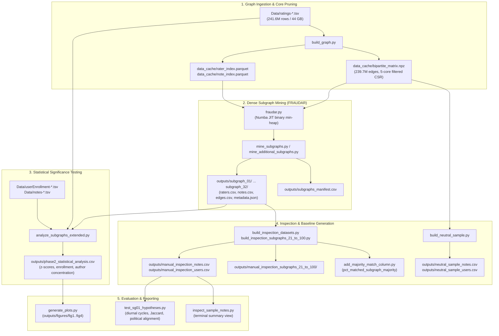

# Community Notes Fraud Detection — Pipeline Scripts Reference

This directory contains the Python scripts that implement the end-to-end pipeline for detecting coordinated inauthentic behavior, collusion rings, and vote manipulation in the **X (formerly Twitter) Community Notes** public dataset.

The system is powered by a high-performance **Numba-accelerated FRAUDAR** (Bounding Graph Fraud in the Face of Camouflage) algorithm adapted for large-scale bipartite interaction graphs (raters $\times$ notes).

---

## Architecture & Execution Workflow



---

## Script Catalog & Detailed Reference

### 1. Ingestion & Graph Pruning

#### [`build_graph.py`](file:///d:/CSC%204740%20Project/src/build_graph.py)
* **Purpose**: Performs memory-efficient streaming chunk ingestion of raw Community Notes rating TSV files, builds the bipartite interaction matrix, and filters it down to a 5-core bipartite graph (retaining only raters and notes with $\ge 5$ interactions).
* **Key Features**:
  * Unified schema handling for legacy (`helpful`, `notHelpful` binary columns) and v2 schemas (`helpfulnessLevel`: `HELPFUL`, `NOT_HELPFUL`, `SOMEWHAT_HELPFUL`).
  * Iterative degree pruning that converged in 6 passes (10.7 seconds).
  * Exports zero-indexed compressed sparse row (CSR) matrix and string ID mapping tables.
* **CLI Arguments**:
  * `--data-dir` (default: `"Data"`): Directory containing raw `ratings-*.tsv`.
  * `--output-dir` (default: `"data_cache"`): Cache directory for generated artifacts.
  * `--min-degree` (default: `5`): Minimum degree threshold for raters and notes.
  * `--max-files` (default: `None`): Optional integer to restrict files for fast testing.
* **Outputs Generated**:
  * `data_cache/bipartite_matrix.npz` (CSR matrix: 1,272,956 raters $\times$ 2,707,054 notes, 239,661,222 edges; ~700 MB).
  * `data_cache/rater_index.parquet` (1,272,956 rater string IDs).
  * `data_cache/note_index.parquet` (2,707,054 note string IDs).
  * `data_cache/graph_stats.json` (graph dimension and density metadata).
* **Usage**:
  ```powershell
  python src/build_graph.py --data-dir Data --output-dir data_cache --min-degree 5
  ```

---

### 2. Core Algorithm Engine & Mining

#### [`fraudar.py`](file:///d:/CSC%204740%20Project/src/fraudar.py)
* **Purpose**: Numba JIT-compiled implementation of the FRAUDAR algorithm ([Hooi et al., KDD 2016](https://dl.acm.org/doi/10.1145/2939672.2939778)) adapted for large bipartite graphs.
* **Key Functions**:
  * `fraudar_peel_core(...)`: Low-level `@njit(fastmath=True)` indexed binary min-heap implementation. Performs $O((V + E) \log V)$ greedy peeling with dynamic key updates.
  * `fraudar_extract(csr_mat, col_weight_c=5.0)`: Computes camouflage-resistant column weights $w_j = \frac{1}{\log(d_j + c)}$ and returns the densest core rater/note index sets.
  * `remove_subgraph_edges(csr_mat, raters, notes)`: In-place zeroing out of all edges between extracted sets $(A_k, B_k)$ and calls `csr_mat.eliminate_zeros()`.

#### [`mine_subgraphs.py`](file:///d:/CSC%204740%20Project/src/mine_subgraphs.py)
* **Purpose**: Initial multi-subgraph extraction loop for top-$K$ subgraphs (default $K=20$).
* **CLI Arguments**:
  * `--cache-dir` (default: `"data_cache"`)
  * `--output-dir` (default: `"outputs"`)
  * `--k-iterations` (default: `20`)
  * `--min-raters` (default: `5`)
  * `--min-notes` (default: `3`)
  * `--col-weight-c` (default: `5.0`)
* **Outputs Generated**:
  * Folders `outputs/subgraph_01/` through `outputs/subgraph_20/`, each containing `metadata.json`, `raters.csv`, `notes.csv`, and `edges.csv`.
  * `outputs/subgraphs_manifest.csv` and `outputs/subgraphs_manifest.json`.

#### [`mine_additional_subgraphs.py`](file:///d:/CSC%204740%20Project/src/mine_additional_subgraphs.py)
* **Purpose**: Extends multi-subgraph peeling up to $K=100$ or until total graph exhaustion. Fast-forwards through previously verified subgraphs and mines all remaining dense cores.
* **CLI Arguments**:
  * `--cache-dir` (default: `"data_cache"`)
  * `--output-dir` (default: `"outputs"`)
  * `--total-k` (default: `100`)
  * `--min-raters` (default: `5`)
  * `--min-notes` (default: `3`)
  * `--col-weight-c` (default: `5.0`)
* **Outputs Generated**:
  * Folders `outputs/subgraph_21/` through `outputs/subgraph_32/` (peeling cleanly terminated at iteration 33 with 0 edges remaining).
  * Updated `outputs/subgraphs_manifest.csv` and `outputs/subgraphs_manifest.json` covering all 32 subgraphs.
* **Usage**:
  ```powershell
  python src/mine_additional_subgraphs.py --total-k 100
  ```

---

### 3. Statistical Analysis & Significance Testing

#### [`analyze_subgraphs.py`](file:///d:/CSC%204740%20Project/src/analyze_subgraphs.py)
* **Purpose**: Initial Phase 2 statistical pipeline for Subgraphs 1–20.
* **CLI Arguments**:
  * `--data-dir` (default: `"Data"`)
  * `--outputs-dir` (default: `"outputs"`)
  * `--max-sample-edges` (default: `100000` for sampling macro components)
* **Outputs Generated**:
  * `outputs/phase2_statistical_analysis.csv`
  * `outputs/phase2_statistical_analysis.json`

#### [`analyze_subgraphs_extended.py`](file:///d:/CSC%204740%20Project/src/analyze_subgraphs_extended.py)
* **Purpose**: Comprehensive Phase 2 statistical analysis across all 32 extracted subgraphs.
* **Metrics Evaluated**:
  1. **User Enrollment**: Two-proportion $z$-test and $p$-values comparing subgraph `earnedIn` rate to the platform baseline ($39.03\%$).
  2. **Note Author & Tweet Concentration**: Unique authors, notes-per-author ratio, top 1 author share %, top 3 authors share %, and unique tweets.
  3. **Helpfulness & Agreement**: Two-proportion $z$-test comparing subgraph helpfulness to platform baseline ($61.55\%$), agreement % and disagreement %.
  4. **Temporal Dynamics**: Active span in days and median delta seconds between ratings.
* **Outputs Generated**:
  * `outputs/phase2_statistical_analysis.csv` (all 32 subgraphs)
  * `outputs/phase2_statistical_analysis.json`
  * `outputs/phase2_statistical_analysis_subgraphs_21_to_100.csv` (filtered slice for subgraphs 21–32)
* **Usage**:
  ```powershell
  python src/analyze_subgraphs_extended.py
  ```

---

### 4. Inspection Datasets & Metric Enrichment

#### [`build_inspection_datasets.py`](file:///d:/CSC%204740%20Project/src/build_inspection_datasets.py)
* **Purpose**: Generates enriched inspection CSVs for initial suspicious subgraphs (excluding macro components 3, 8, 13, 16, 20).
* **CLI Arguments**:
  * `--data-dir` (default: `"Data"`)
  * `--outputs-dir` (default: `"outputs"`)
  * `--exclude-subgraphs` (default: `3 8 13 16 20`)
* **Outputs Generated**:
  * `outputs/manual_inspection_notes.csv` (277,111 rows)
  * `outputs/manual_inspection_users.csv` (150,144 rows)

#### [`build_inspection_subgraphs_21_to_100.py`](file:///d:/CSC%204740%20Project/src/build_inspection_subgraphs_21_to_100.py)
* **Purpose**: Builds per-subgraph inspection CSVs and consolidated master inspection files for Subgraphs 21 through 32, computing the `pct_matched_subgraph_majority` concordance column in a single streaming pass.
* **CLI Arguments**:
  * `--data-dir` (default: `"Data"`)
  * `--outputs-dir` (default: `"outputs"`)
  * `--start-k` (default: `21`)
  * `--end-k` (default: `100`)
* **Outputs Generated**:
  * Dedicated per-subgraph files in `outputs/manual_inspection_subgraphs_21_to_100/`:
    * `subgraph_21_notes.csv` / `subgraph_21_users.csv` ... `subgraph_32_notes.csv` / `subgraph_32_users.csv`.
  * Local mirrors inside each `outputs/subgraph_XX/`:
    * `manual_inspection_notes.csv` and `manual_inspection_users.csv`.
  * Combined master batch CSVs:
    * `outputs/manual_inspection_notes_subgraphs_21_to_100.csv` (3,604,504 rows).
    * `outputs/manual_inspection_users_subgraphs_21_to_100.csv` (2,599,397 rows).
* **Usage**:
  ```powershell
  python src/build_inspection_subgraphs_21_to_100.py --start-k 21 --end-k 100
  ```

#### [`add_majority_match_column.py`](file:///d:/CSC%204740%20Project/src/add_majority_match_column.py)
* **Purpose**: Computes the majority concordance metric for each user in earlier batches:
  $$\text{pct\_matched\_subgraph\_majority} = \frac{\sum \mathbb{I}(\text{user\_vote} == \text{subgraph\_majority\_vote})}{\text{ratings\_on\_notes\_with\_defined\_majority}} \times 100$$
* **Outputs Generated**:
  * Updates `outputs/manual_inspection_users.csv` (or saves to `manual_inspection_users_with_majority.csv` if file-locked by Excel).
  * Updates `outputs/combined_inspection_users.csv`.
  * Permanent cache: `data_cache/user_majority_concordance.parquet`.

#### [`build_neutral_sample.py`](file:///d:/CSC%204740%20Project/src/build_neutral_sample.py)
* **Purpose**: Extracts a reproducible control baseline of 10,000 randomly chosen active notes and 10,000 randomly chosen active users ($\ge 5$ interactions) with schema matching the inspection CSVs.
* **CLI Arguments**:
  * `--data-dir` (default: `"Data"`)
  * `--cache-dir` (default: `"data_cache"`)
  * `--outputs-dir` (default: `"outputs"`)
  * `--sample-size` (default: `10000`)
  * `--seed` (default: `42`)
* **Outputs Generated**:
  * `outputs/neutral_sample_notes.csv` (10,000 notes with `subgraph_id: 0`).
  * `outputs/neutral_sample_users.csv` (10,000 users with `subgraph_id: 0`).
  * `outputs/combined_inspection_notes.csv` (Control + Subgraphs combined).
  * `outputs/combined_inspection_users.csv` (Control + Subgraphs combined).

#### [`inspect_sample_notes.py`](file:///d:/CSC%204740%20Project/src/inspect_sample_notes.py)
* **Purpose**: Lightweight console inspection utility that prints top notes, tweet links, vote distributions, and summaries for key rings (e.g. Subgraphs 14, 17, 15, 2).

---

### 5. Research & Specialized Testing

#### [`test_sg01_hypotheses.py`](file:///d:/CSC%204740%20Project/src/test_sg01_hypotheses.py)
* **Purpose**: Deep-dive hypothesis testing suite investigating whether the polarized bimodal distribution in Subgraph 01 (19,484 raters, 31,271 notes, 16.2M edges) represents synthetic Sybil bots or organic political polarization.
* **Tests Executed**:
  1. **Strategic Note Bridge Test**: 4-quadrant cross-tabulation of liberal vs. conservative ratings across all 31,271 notes. (Found 73.8% contentious/disagreed notes; only 0.23% strategic bridging notes).
  2. **Intra-Cohort Jaccard Similarity**: Evaluates pairwise overlap. (Found mean Jaccard of only 2.0% in SG-01 vs. 90.0% in synthetic cliques like SG-14).
  3. **Circadian Rhythm & Diurnal Analysis**: UTC hour rating distribution across 16.2M timestamps. (Found a strong 2.5× diurnal sleep-wake curve with trough at 09:00 UTC, rejecting 24/7 automated bot scripts).
* **Outputs Generated**:
  * `outputs/sg01_notes_left_right_breakdown.csv` (31,271 notes annotated with Left/Right agreement percentages and quadrant classifications).

#### [`generate_plots.py`](file:///d:/CSC%204740%20Project/src/generate_plots.py)
* **Purpose**: Generates 300 DPI publication figures visualizing fraud signatures.
* **Outputs Generated**:
  * `outputs/figures/fig1_density_vs_helpfulness.png`: Density vs. helpfulness skew scatter plot.
  * `outputs/figures/fig2_earned_in_proportions.png`: Earned-in rater proportions across all subgraphs vs. baseline.
  * `outputs/figures/fig3_author_concentration.png`: Single-author and top-3 author concentration bar chart.
  * `outputs/figures/fig4_subgraph14_adjacency_matrix.png`: Adjacency matrix spy plot of Subgraph 14 (33 raters $\times$ 520 notes).

---

## Complete End-to-End Execution Guide

To reproduce all findings from raw Community Notes data completely from scratch:

```powershell
# 1. Ingest raw ratings and construct the 5-core bipartite interaction graph
python src/build_graph.py --min-degree 5

# 2. Mine all dense subgraphs using FRAUDAR (Subgraphs 1 to 32, runs until total graph exhaustion)
python src/mine_additional_subgraphs.py --total-k 100

# 3. Run Phase 2 statistical significance testing across all 32 subgraphs
python src/analyze_subgraphs_extended.py

# 4. Generate manual inspection datasets for Subgraphs 1 to 20 (excluding macro background components)
python src/build_inspection_datasets.py --exclude-subgraphs 3 8 13 16 20

# 5. Add majority match concordance metric (pct_matched_subgraph_majority) to Subgraphs 1 to 20 users
python src/add_majority_match_column.py

# 6. Generate manual inspection datasets for Subgraphs 21 to 32 (with built-in majority concordance)
python src/build_inspection_subgraphs_21_to_100.py --start-k 21 --end-k 100

# 7. Extract neutral control baseline (10k notes / 10k users) and build combined inspection files
python src/build_neutral_sample.py --sample-size 10000

# 8. Execute SG-01 deep-dive empirical hypothesis tests (diurnal rhythm, Jaccard overlap, bridge analysis)
python src/test_sg01_hypotheses.py

# 9. Render publication-quality figures
python src/generate_plots.py
```

---

## File Schema Standards

### Note Inspection File Schema
Used in `manual_inspection_notes.csv`, `neutral_sample_notes.csv`, and all `subgraph_XX_notes.csv`:

| Column Name | Data Type | Description |
| :--- | :--- | :--- |
| `subgraph_id` | `Int16` | Subgraph identifier (`0` for neutral control baseline) |
| `noteId` | `Utf8` | Community Notes 64-bit numerical string ID |
| `writer_user_id` | `Utf8` | 64-character SHA-256 rater hash of note author |
| `status` | `Utf8` | Classification (`MISINFORMED_OR_POTENTIALLY_MISLEADING`, `NOT_MISLEADING`) |
| `timestamp_utc` | `Utf8` | Formatted UTC string (`YYYY-MM-DD HH:MM:SS UTC`) |
| `timestamp_epoch_ms` | `Int64` | Millisecond Unix epoch timestamp |
| `tweet_id` | `Utf8` | Associated X / Twitter status ID |
| `tweet_url` | `Utf8` | Direct link (`https://x.com/i/web/status/<tweet_id>`) |
| `subgraph_ratings_count` | `UInt32` | Number of ratings on this note from raters within this subgraph |
| `subgraph_helpful_count` | `UInt32` | Number of helpful ratings from raters within this subgraph |
| `pct_of_ratings_helpful` | `Float64` | `subgraph_helpful_count / subgraph_ratings_count * 100` |
| `total_subgraph_raters` | `UInt32` | Total rater population size of this subgraph |
| `pct_of_subgraph_raters_helpful` | `Float64` | `subgraph_helpful_count / total_subgraph_raters * 100` |
| `note_summary` | `Utf8` | Plain text explanation submitted by the note author |

### User Inspection File Schema
Used in `manual_inspection_users.csv`, `neutral_sample_users.csv`, and all `subgraph_XX_users.csv`:

| Column Name | Data Type | Description |
| :--- | :--- | :--- |
| `subgraph_id` | `Int16` | Subgraph identifier (`0` for neutral control baseline) |
| `raterParticipantId` | `Utf8` | 64-character SHA-256 rater account hash |
| `enrollment_status` | `Utf8` | Status (`earnedIn`, `newUser`, `atRisk`, `removed`) |
| `subgraph_notes_rated_count` | `UInt32` | Number of notes rated by this user within this subgraph |
| `subgraph_notes_helpful_count` | `UInt32` | Number of helpful ratings cast by this user in this subgraph |
| `pct_of_ratings_helpful` | `Float64` | `helpful_count / notes_rated_count * 100` |
| `pct_matched_subgraph_majority` | `Float64` | % of ratings agreeing with majority vote of the subgraph |
| `total_subgraph_notes` | `UInt32` | Total number of notes in this subgraph |
| `pct_of_subgraph_notes_rated_helpful` | `Float64` | `helpful_count / total_subgraph_notes * 100` |
| `successfulRatingNeededToEarnIn` | `Int32` | Community Notes onboarding credit counter |
| `numberOfTimesEarnedOut` | `Int32` | Penalty strike counter |
| `modelingGroup` | `Float64` | Matrix factorization latent group assignment (0.0–25.0) |
